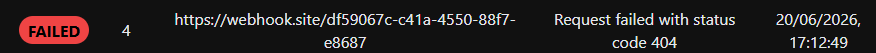

# NotifyFlow – Event-Driven Webhook Delivery System

**Live dashboard:** https://notifyme-woad.vercel.app/  
**API:** https://notifyflow-api-kbx4.onrender.com

> Deployed on free tiers. The API sleeps when idle, so the first request after a quiet period can take 30 to 60 seconds.

---

## Overview

NotifyFlow is a failure-tolerant backend system that delivers webhook notifications using asynchronous processing, classified retries, and observability.

Instead of calling webhooks directly from the API, each request is persisted in PostgreSQL, queued in BullMQ/Redis, delivered by a background worker, retried when the failure is transient, and tracked through its whole lifecycle.

Delivery is **at-least-once**. Every webhook carries an `Idempotency-Key` header (the notification ID) so receivers can deduplicate.

---

## Architecture

```text
Client (browser)
   ↓
React Dashboard (Vercel)
   ↓ HTTPS
Express API / Producer (Render)
   ↓
PostgreSQL (Neon)          ← source of truth for business status
   ↓
BullMQ Queue (Redis)       ← queue runtime state
   ↓
Worker / Consumer (+ reconciler)
   ↓
External Webhook
   ↓
Update DB status
```

Key principles:

1. PostgreSQL owns business status. BullMQ owns queue runtime state.
2. At-least-once delivery with idempotency keys, never exactly-once.
3. SSRF protection at delivery time, enforced on every resolved address.
4. The reconciler runs in exactly one place: the worker process.

---

## Tech Stack

| Layer | Technology |
|-------|------------|
| Backend | Node.js 22 (CI), Express 5, TypeScript 5.9 |
| Database | PostgreSQL (Neon in deployment, `postgres:16` in Docker locally), Prisma 6.19 with migrations |
| Queue | BullMQ 5, Redis (ioredis 5) |
| Security | ipaddr.js 2 for IP range checks |
| Logging | pino 10 (structured JSON, pino-pretty in dev) |
| Tests | vitest |
| Frontend | React, Vite, Axios |
| Hosting | Vercel (dashboard), Render (API and Redis), Neon (PostgreSQL) |
| CI | GitHub Actions |
| Local infra | Docker Compose, PM2 config for VM hosting |

---

## Features

### Producer / consumer separation
The API never sends webhooks. The worker never serves HTTP and hosts the reconciler. They run as separate processes locally, in Docker, and under PM2. For free-tier hosting there is also a co-located mode (`start:all`) that runs the API and worker as two child processes in one service and forwards shutdown signals to both.

### Classified retries
Up to 4 attempts with exponential backoff (2s, 4s, 8s) plus up to 20% random jitter. Failures are classified, and only transient ones are retried.

| Failure | Category | Behaviour |
|---------|----------|-----------|
| Network errors (ECONNREFUSED, ECONNRESET, ...) | `NETWORK_ERROR` | Retry |
| Timeout (5 s) | `TIMEOUT` | Retry |
| 5xx | `HTTP_5XX` | Retry |
| 408, 429 | `HTTP_4XX` | Retry |
| DNS lookup failure | `DNS_FAILURE` | Retry |
| Other 4xx | `HTTP_4XX` | FAILED immediately |
| Blocked target address | `SSRF_BLOCKED` | FAILED immediately |
| 3xx (redirects disabled), unexpected status | `UNKNOWN` | FAILED immediately |
| Anything else | `UNKNOWN` | Retry |

A notification is marked `FAILED` when the error is unrecoverable or the attempts are exhausted.

### At-least-once delivery with idempotency keys
The BullMQ `jobId` is the notification ID, so re-enqueueing is safe. Every outbound request carries `Idempotency-Key: <notification id>`.

### Terminal-state guard
At the start of every job the worker loads the row and returns early if it is already `SUCCESS` or `FAILED`, so a job re-run after a stall never delivers twice. BullMQ's job lock is what prevents two workers from running the same job at once.

### Reconciler
Runs in the worker process every 60 seconds (with an in-flight guard) and repairs stale state between PostgreSQL and the queue. It scans up to 100 rows, oldest first:

- `PENDING` for more than 2 minutes, or `PROCESSING` for more than 10 minutes.
- For each row it checks `queue.getJob(id)`: a missing job is re-added, a failed job marks the row `FAILED`, a completed job marks it `SUCCESS`, and waiting/active/delayed jobs are left alone.

The `getJob` check matters because BullMQ ignores `add()` for a retained job id, and without it a permanently failed webhook could be re-delivered after retention expires.

### SSRF protection
- Creation does a syntax check only (HTTPS, hostname present, IP literals in blocked ranges rejected).
- Enforcement happens at delivery: IP literals are validated directly, and hostnames go through a custom `lookup` on the `https.Agent` that checks every resolved address against the block list before connecting. SNI and certificate validation still use the hostname.
- Blocked ranges: `0.0.0.0/8`, `10.0.0.0/8`, `100.64.0.0/10`, `127.0.0.0/8`, `169.254.0.0/16`, `172.16.0.0/12`, `192.168.0.0/16`, `::1/128`, `::/128`, `fc00::/7`, `fe80::/10`, and IPv4-mapped IPv6 (the embedded IPv4 address is checked).
- Redirects are disabled and environment proxies are ignored (`maxRedirects: 0`, `proxy: false`).
- `ALLOW_PRIVATE_WEBHOOK_TARGETS=true` skips the check for local development, and is ignored when `NODE_ENV=production`.

### Delivery safety
5 second hard timeout (`timeout` plus `AbortSignal.timeout`), 1 MB response cap, 1 MB request body limit (413 on oversize), and `lastError` stores only a fixed category (never a raw error). Raw errors go to structured logs with a small summary (jobId, notificationId, attempt, category, httpStatus), not the full Axios error, so headers and payloads are never logged.

### Graceful shutdown
API and worker handle both `SIGTERM` and `SIGINT` once. A 10 second safety timer starts first, then the reconciler is stopped, then the worker/server, queue, Prisma and Redis are closed.

### Observability
`/metrics` returns BullMQ gauges and Postgres status totals, `/health` supports platform health checks, and pino logs carry `jobId`, `notificationId` and `attempt`.

### Dashboard
Create form (shows API validation errors), paginated notifications table with status filter, status badges, retry counts, error category and HTTP status, queue gauges and database totals.

---

## Notification Lifecycle

```text
PENDING
   ↓
PROCESSING
   ├── success ───────────────────────────→ SUCCESS
   ├── transient failure → retry (2s, 4s, 8s + jitter)
   │        └── attempts exhausted ───────→ FAILED
   └── unrecoverable error ───────────────→ FAILED (immediately)
```

`retries` counts attempts completed so far. The status stays `PROCESSING` between retries. BullMQ states (waiting, active, delayed) are runtime gauges, not business statuses.

---

## Database Schema

Prisma model `Notification`:

| Field | Type | Description |
|-------|------|-------------|
| id | String (UUID) | Primary key, also the BullMQ `jobId` |
| type | String | `webhook` (default, extensible) |
| url | String | Target endpoint |
| payload | Json | Request body (max 1 MB) |
| status | Enum | `PENDING` / `PROCESSING` / `SUCCESS` / `FAILED` |
| retries | Int | Attempts completed so far (default 0) |
| lastError | String? | Sanitized error category only |
| httpStatus | Int? | Last HTTP status, when the failure was an HTTP response |
| createdAt | DateTime | Creation time |
| updatedAt | DateTime | Last state change |

Indexes: `(status, createdAt)` for dashboard queries and the reconciler, and `(createdAt)` for pagination.

---

## API Endpoints

| Method | Endpoint | Description |
|--------|----------|-------------|
| GET | `/health` | Returns `{"status":"ok"}`. Does not touch the DB or Redis. |
| POST | `/notifications` | Validate, save as `PENDING`, enqueue, return `201` immediately |
| GET | `/notifications` | Paginated list: `?status=&page=&limit=` (default limit 20, max 100) |
| GET | `/notifications/:id` | Single notification, `404` if not found |
| GET | `/metrics` | Queue gauges and database status totals |

### Create a notification

```http
POST /notifications
```

```json
{
  "type": "webhook",
  "url": "https://example.com/webhook",
  "payload": {
    "message": "Hello World"
  }
}
```

`url` must be HTTPS and `payload` must be a JSON object (max 1 MB). If the enqueue fails after the row is saved, the API still returns `201` and the reconciler re-enqueues the stuck row.

### List response

```json
{ "data": [], "page": 1, "limit": 20, "total": 0, "totalPages": 0 }
```

### Metrics response

```json
{
  "queue":    { "waiting": 0, "active": 0, "delayed": 0 },
  "database": { "PENDING": 0, "PROCESSING": 0, "SUCCESS": 0, "FAILED": 0 }
}
```

Errors: `400` for validation failures or malformed JSON, `413` for bodies over 1 MB, `500` for anything unhandled.

---

## Configuration

Copy `apps/api/.env.example` and `apps/web/.env.example` to local env files and fill in the values.

| Variable | Used by | Purpose |
|----------|---------|---------|
| `PORT` | API | Listen port (3000) |
| `DATABASE_URL` | API, worker | Database URL (the pooled URL on Neon) |
| `DATABASE_URL_UNPOOLED` | Prisma CLI | Direct Neon URL, used for migrations |
| `REDIS_URL` | API, worker | Redis connection string |
| `REDIS_HOST` / `REDIS_PORT` / `REDIS_PASSWORD` / `REDIS_TLS` | API, worker | Alternative to `REDIS_URL` |
| `NODE_ENV` | API, worker | Production behaviour |
| `ALLOW_PRIVATE_WEBHOOK_TARGETS` | Worker | Dev-only SSRF toggle |
| `LOG_LEVEL` | API, worker | pino log level |
| `VITE_API_URL` | Web (build time) | Public API base URL, falls back to `http://localhost:3000` |

Keep credentials in environment variables or a secret manager, never in the repo. For local webhook development, [webhook.site](https://webhook.site) is a convenient receiver (the block list rejects `localhost` targets).

---

## Local Development

```bash
# Start Postgres and Redis
docker compose up -d postgres redis

# Install dependencies and apply migrations
pnpm install --frozen-lockfile
pnpm --filter api exec prisma migrate deploy

# Run each process in its own terminal
pnpm --filter api dev       # API
pnpm --filter api worker    # Worker + reconciler
pnpm --filter web dev       # Dashboard
```

API scripts: `dev`, `worker`, `build`, `start` (API only), `start:worker`, `start:all` (API and worker as two child processes), `typecheck`, `test`.

---

## Deployment

| Component | Host |
|-----------|------|
| Dashboard | Vercel |
| API | Render web service (`notifyflow-api`, free) |
| Redis | Render Key Value (free, `noeviction`, internal only) |
| Database | Neon PostgreSQL |

Vercel and Render both deploy from `main`.

**Vercel.** `vercel.json` at the repository root sets the install command (`pnpm install --frozen-lockfile`), build command (`pnpm --filter web build`) and output directory (`apps/web/dist`). The project's Root Directory must be the repository root with "Include files outside the root directory" enabled. `VITE_API_URL` must point at the Render API URL (no trailing slash) and is inlined at build time, so changing it needs a redeploy.

**Render.** `render.yaml` defines the Key Value instance and the `notifyflow-api` web service (health check path `/health`). Build: `pnpm install --frozen-lockfile && pnpm --filter api exec prisma generate && pnpm --filter api build`. The committed start command is `pnpm --filter api start`, which runs the API only. Render has no free background worker, so to run delivery and the reconciler on the free tier set the start command to `pnpm --filter api start:all`, or run `pnpm --filter api start:worker` as a separate paid worker.

**Neon.** Migrations are not run by the Render start command. Apply them manually with the direct (unpooled) connection string:

```bash
pnpm --filter api exec prisma migrate deploy
pnpm --filter api exec prisma migrate status
```

Neon provides a pooled URL (`DATABASE_URL`, host contains `-pooler`) and a direct URL (`DATABASE_URL_UNPOOLED`). If the CLI reports the pooled host, set `DATABASE_URL` to the direct string for the migration command.

**Free-tier behaviour.** The Render web service sleeps after about 15 minutes idle and takes roughly 30 to 60 seconds to wake, and a co-located worker, retries and the reconciler pause with it. Free Render Key Value is small (25 MB) and not persisted, so a restart can lose queued jobs, and the reconciler re-enqueues rows that never finished. Neon's free tier scales to zero, so the first query after idle is slower.

### Optional: VM hosting

The repo keeps `ecosystem.config.js` (PM2, one instance each for API and worker, `kill_timeout` 15000) and a gated CI deploy job (`DEPLOY_ENABLED == 'true'`) for hosting on a VM such as EC2. If you host this way: enforce IMDSv2, use an Elastic IP so a Redis Cloud allowlist stays valid, use TLS and the `noeviction` policy on Redis, and supply RDS and Redis credentials through environment variables or SSM Parameter Store. The Render and Vercel deployment does not use this path.

---

## Testing and CI

```bash
pnpm --filter api test
```

The vitest suite runs with no real Redis, database or network. It covers retry classification, delivery configuration, the processor (attempt counting and terminal-state guard), reconciler outcomes, the SSRF block list and lookup callback, and request validation.

GitHub Actions runs on every push and pull request: install, `prisma generate`, API typecheck, web build, and API tests. Vercel and Render deploy automatically from `main`.

---

## Verification Status

- **Verified locally:** a 200 webhook delivery with the `Idempotency-Key` header, and 404 fail-fast.
- **Unit-tested:** retry classification, processor logic, reconciler outcomes, SSRF block list.
- **Not yet verified end to end:** the retry path against live 5xx/429/timeout responses, SSRF protection against live bypass attempts (redirects, DNS rebinding), failure injection, and the worker running in the deployed service.

---

## Known Limitations

- The create endpoint has no inbound idempotency key, so client retries can create duplicates.
- Webhook requests have no HMAC signature.
- The API has no authentication. Anyone who can reach it can make the server POST to arbitrary public HTTPS URLs (SSRF protection limits targets to public addresses).
- CORS is currently open to all origins and should be restricted to the Vercel origin.
- No outbound rate limiting, manual retry, dead-letter queue or alerting. A `FAILED` notification stays `FAILED` and remains visible in the dashboard.
- Migrations are manual.
- Free-tier limits apply (sleeping API, non-persistent Redis), see Deployment.

---

## Project Structure

```text
.
├── apps/
│   ├── api/                 # Express API, worker, reconciler, Prisma
│   └── web/                 # Vite + React dashboard
├── .github/workflows/ci.yml # CI
├── docker-compose.yml       # Local Postgres + Redis
├── ecosystem.config.js      # PM2 config for VM hosting
├── render.yaml              # Render blueprint
└── vercel.json              # Vercel build config
```

---

## Screenshots

### Dashboard


### Notification Creation


### Successful Delivery


### Failed Notification



### History


