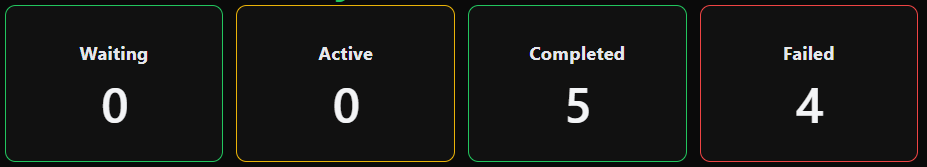
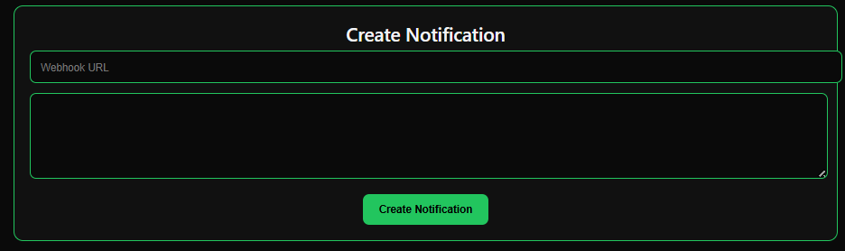
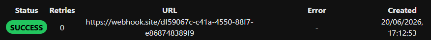
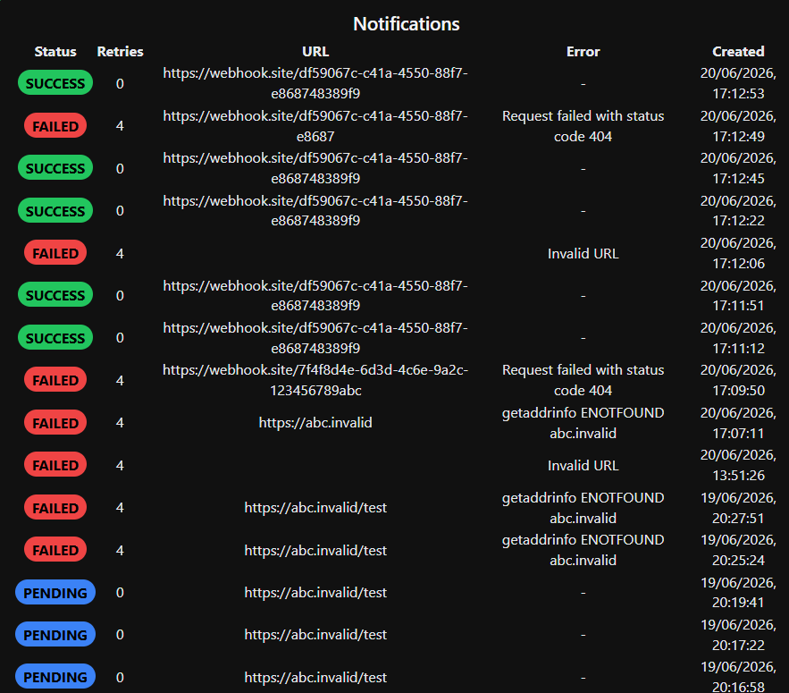

# NotifyFlow – Event-Driven Notification System

## Overview

NotifyFlow is a failure-tolerant event-driven notification delivery system built to demonstrate real-world backend engineering concepts such as asynchronous processing, queue-based architectures, retry mechanisms, failure handling, observability, and distributed system design.

Instead of sending notifications directly from the API, requests are persisted, queued, processed by background workers, retried on failure, and tracked throughout their lifecycle.

---

## Architecture

```text
Client
   ↓
React Dashboard
   ↓
Express API (Producer)
   ↓
PostgreSQL
   ↓
BullMQ Queue
   ↓
Redis
   ↓
Worker Process (Consumer)
   ↓
External Webhook
   ↓
Status Update
````

---

## Tech Stack

### Backend
- Node.js
- Express.js
- TypeScript

### Database
- PostgreSQL
- Prisma ORM

### Queue & Messaging
- Redis
- BullMQ

### Frontend
- React
- Vite
- Axios

### Infrastructure
- Docker
- Docker Compose

---

## Features

### Notification Creation
- Create notifications through API or Dashboard
- Validate input payloads
- Store notifications in PostgreSQL

### Queue-Based Processing
- BullMQ queue integration
- Redis-backed job management
- Decoupled API and processing logic

### Worker System
- Dedicated worker process
- Independent background execution
- Consumer architecture

### Webhook Delivery
- Sends payloads to external webhook endpoints
- Tracks delivery status
- Updates database after execution

### Retry Mechanism
- Automatic retries on failure
- Exponential backoff strategy

Example:

```text
Retry 1 → 2 seconds
Retry 2 → 4 seconds
Retry 3 → 8 seconds
Retry 4 → 16 seconds
```

### Failure Tracking
- Failed notifications are never lost
- Error messages stored in database
- Retry count tracking
- Permanent failure state support

### Observability
- Metrics endpoint
- Queue monitoring
- Failed job monitoring
- Processing statistics

### Dashboard
- Create notifications
- View notification history
- Status badges
- Retry counts
- Error visibility
- Metrics cards

---

## Notification Lifecycle

```text
PENDING
   ↓
QUEUED
   ↓
PROCESSING
   ↓
SUCCESS

OR

PROCESSING
   ↓
RETRY
   ↓
RETRY
   ↓
FAILED
```

---

## Database Schema

### Notification

| Field | Description |
|---------|---------|
| id | Unique identifier |
| url | Webhook endpoint |
| payload | Notification payload |
| status | Current state |
| retries | Retry count |
| lastError | Latest error message |
| createdAt | Creation timestamp |

---

## API Endpoints

### Create Notification

```http
POST /notifications
```

Example:

```json
{
  "url": "https://example.com/webhook",
  "payload": {
    "message": "Hello World"
  }
}
```

---

### Get Notifications

```http
GET /notifications
```

Returns all notifications with status and retry information.

---

### Metrics

```http
GET /metrics
```

Returns:

- Waiting jobs
- Active jobs
- Completed jobs
- Failed jobs

---

## Docker Setup

### Start Infrastructure

```bash
docker compose up postgres redis
```

### Start API

```bash
pnpm dev
```

### Start Worker

```bash
pnpm worker
```

### Start Dashboard

```bash
pnpm dev
```

---

## Screenshots

### Dashboard



---

### Notification Creation



---

### Successful Delivery



---

### Failed Notification


---

### History Dashboard



---

## Key Concepts Demonstrated

- Asynchronous Processing
- Producer Consumer Architecture
- Queue Systems
- Redis
- BullMQ
- Worker Processes
- Reliability Engineering
- Retry Strategies
- Exponential Backoff
- Failure Handling
- Observability
- System Design Thinking
- Event-Driven Architecture

---

## Common Failure Scenarios Tested

### Invalid Webhook

```text
404 Not Found
```

### Invalid Domain

```text
getaddrinfo ENOTFOUND abc.invalid
```

### Retry Verification

- Retry 1
- Retry 2
- Retry 3
- Retry 4
- Mark as FAILED


## NotifyFlow v3

The API persists notifications in PostgreSQL and queues delivery in BullMQ/Redis. A single worker performs HTTPS webhook delivery with bounded request/response sizes, no redirects, DNS-time SSRF protection, and retry classification. A worker-only reconciler repairs stale queue/database state. Delivery is at-least-once: receivers should deduplicate using the `Idempotency-Key` header containing the notification ID.

### Configuration

Copy `apps/api/.env.example` and `apps/web/.env.example` to local env files and fill in values. API variables: `PORT`, `DATABASE_URL`, `REDIS_HOST`, `REDIS_PORT`, `REDIS_PASSWORD`, `REDIS_TLS`, `NODE_ENV`, `ALLOW_PRIVATE_WEBHOOK_TARGETS`, and `LOG_LEVEL`. Frontend: `VITE_API_URL`. Keep credentials in environment variables or a secret manager. For local webhook development, [webhook.site](https://webhook.site) is a recommended receiver. The private-target development toggle is only honored outside production.

### Local development

Run `docker compose up -d postgres redis` from the repository root, then install dependencies with `pnpm install --frozen-lockfile`. Run the API with `pnpm --filter api dev`, the worker with `pnpm --filter api worker`, and the frontend with `pnpm --filter web dev`. Apply migrations with `pnpm --filter api exec prisma migrate deploy`.

### API endpoints

- `POST /notifications` creates a webhook notification from `{ "type": "webhook", "url": "https://…", "payload": {} }`.
- `GET /notifications?page=1&limit=20&status=PENDING` returns a paginated notification list.
- `GET /notifications/:id` returns one notification.
- `GET /metrics` returns queue gauges and database status totals.
- `GET /health` reports API health.

### AWS deployment notes

Enforce IMDSv2 on the EC2 instance. Use an Elastic IP so the Redis Cloud allowlist stays valid. Redis Cloud should use TLS and the `noeviction` policy. Supply RDS and Redis credentials through environment variables or SSM Parameter Store. Grant the EC2 IAM role access to SSM only.

### Known limitations

- The create endpoint has no inbound idempotency key.
- Webhook requests do not have HMAC signatures.
- The API has no authentication. Anyone who can reach it can ask the server to POST to arbitrary public HTTPS URLs; SSRF protection limits targets to public addresses.
- Outbound rate limiting and CloudWatch integration are not implemented.
- SSRF protection has not been tested against live bypass attempts beyond the unit tests.
- The system has not been tested with failure injection.